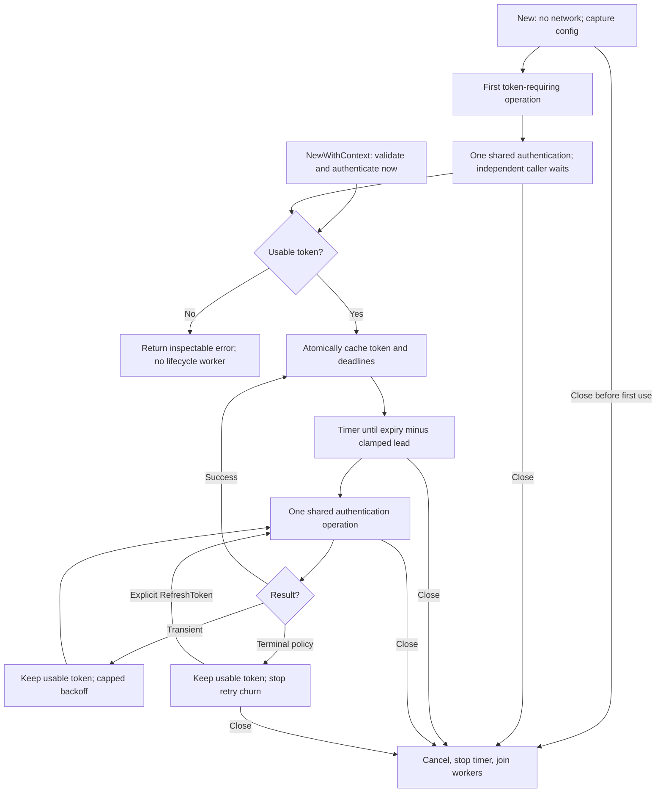

# Authentication

`New()` or `New(config)` performs no network request. The first `SendSMS`,
`Topup`, or `RefreshToken` requiring a token sends one coordinated
`POST /api/v1/Connect/token` with `clientID`, `secret`, and
`grantType: "client_credentials"`. With no config, credentials are captured from
`TELBIZ_CLIENT_ID` and `TELBIZ_CLIENT_SECRET` once. Explicit config never falls back
to environment values. Invalid config, including more than one config, is stored
and returned as `ErrValidation` by operations before authentication or submission.
A valid lazy client starts no auth worker or renewal timer until first token use.

`NewWithContext(ctx, config)` validates and authenticates immediately, returning
initialization errors directly. Its nonnil context governs that request only.
A failed eager constructor closes its resources and leaves no worker or timer.
Migrate old `New(ctx, config)` calls to `NewWithContext` to preserve eager behavior.

An authentication response needs `success:true`, a nonblank safe header token,
and a positive integer `expire` in **seconds**. Missing, quoted, fractional,
zero, negative, overflowing, or already exhausted lifetimes are rejected.

Expiry is `request start + returned lifetime`, so response latency never extends
token validity. This follows the authentication schema despite the provider
overview's conflicting `3600 ms` label. No lifetime is hardcoded to one hour.

## Automatic renewal

After the first successful authentication, one lifecycle loop schedules renewal
using timers, including while idle. With `expire:3600` and the default lead, it starts
at 3,540 seconds. Effective lead is `min(RefreshBefore, lifetime/2)`; a ten-second
token renews at five seconds. If authentication latency has passed the computed
renewal point, renewal is scheduled at least **100 milliseconds** after response
processing. This prevents a success/renewal spin for slow, short-lived responses;
an exceptionally short remaining lifetime can expire during that delay.

Renewal repeats the same authentication request with the original credentials.
It does not use a refresh token, change the Client ID/Secret, or coordinate with
other SDK clients or processes. The provider has not specified whether obtaining
a token invalidates an overlapping token; this remains an integration uncertainty.

## Concurrent callers

Background renewal, service calls requiring authentication, and `RefreshToken`
share at most one authentication operation per client. Token and deadlines are
replaced together. No state lock is held during network I/O or waiter blocking.
Service calls can use an unexpired old token while renewal is pending or failing.
If no usable token exists, callers join/start allowed renewal and submit nothing
when authentication fails. The token deadline is checked again at service
admission; expiry before admission causes another acquisition with no service POST.

`RefreshToken(ctx)` forces one authentication attempt, or joins an attempt already
in progress. It returns no token. Caller cancellation affects that caller's wait
only, including cancellation of the very first service caller. Shared first-use
and renewal work use the client-owned lifecycle context plus `Config.Timeout`
(default 30 seconds). An earlier service deadline ends its wait while shared auth
continues, even if all waiters have canceled. The resulting token still starts
idle renewal. A service 401 invalidates only the generation used by that call if it is still current;
a late 401 cannot invalidate a newer token. The current service error is returned
without replay. Neither a generic `REQUEST_FAIL` nor a 403 invalidates tokens.

## Failures and retry policy

Each coordinated attempt makes one bounded authentication POST. Eager
`NewWithContext` also makes only one attempt. Before any successful lazy
authentication, no lifecycle worker runs: a transient first-use failure sets a
shared cooldown; a later operation can attempt again after that cooldown.
A terminal first-use failure is retained until explicit `RefreshToken` recovery.
After the first success, the lifecycle retries transient failures with
delays of **1, 2, 4, 8, 16, then 30 seconds**, retaining the 30-second cap.
If an unexpired old token has less remaining life than the delay, the next retry
is advanced to expiry, with a 100-ms minimum delay. After expiry, capped backoff
continues; it never becomes a zero-delay loop. A successful renewal resets backoff.

The following classification is SDK policy, not a provider HTTP mapping:

| Failure | Automatic behavior |
|---|---|
| HTTP 408, 429, or 5xx | Transient; schedule bounded backoff |
| Transport/network error or request deadline with no HTTP status | Transient, except lifecycle cancellation |
| Other HTTP failures, including 400/401/403 and redirects | Stop automatic retries |
| HTTP success containing provider `success:false`, including unknown codes | Stop automatic retries |
| Malformed/unusable successful response | Stop automatic retries |

Stopping automatic retry churn does not assert that every such failure proves
invalid credentials. The inspectable error preserves HTTP status/code where
available. Provider rejections of unknown codes use the explicit policy above.

A failed renewal never erases an unexpired token. When authentication becomes
necessary, service calls expose the stored authentication error during cooldown
or after automatic retries stop. New concurrent and sequential callers cannot
bypass transient cooldown; even manual refresh observes it. Explicit manual
refresh can retry a terminal failure immediately. There is no logging or
exported token getter/diagnostic hook.

## Shutdown

`NewWithContext`'s context is initialization-only; `New` takes no context.
`Close()` is safe before first use and prevents later authentication. It marks
the client closed, cancels lifecycle authentication, stops its timer, unblocks waiters, and
joins client-owned workers. Repeated and concurrent calls are safe. SDK-owned
idle connections are closed; injected resources remain caller-owned. Calls
admitted before closure may finish with their own contexts and HTTP timeouts.

See [manual renewal](../examples/refresh/main.go), [lifecycle](../examples/lifecycle/main.go),
and the [provider snapshot](TELBIZ_API_REFERENCE.md).
