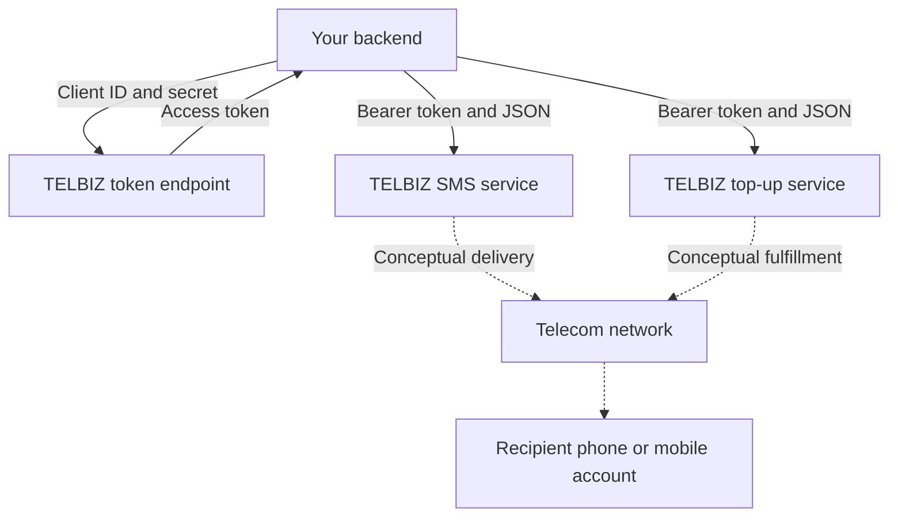
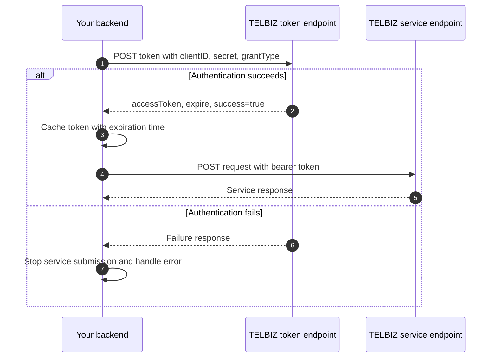
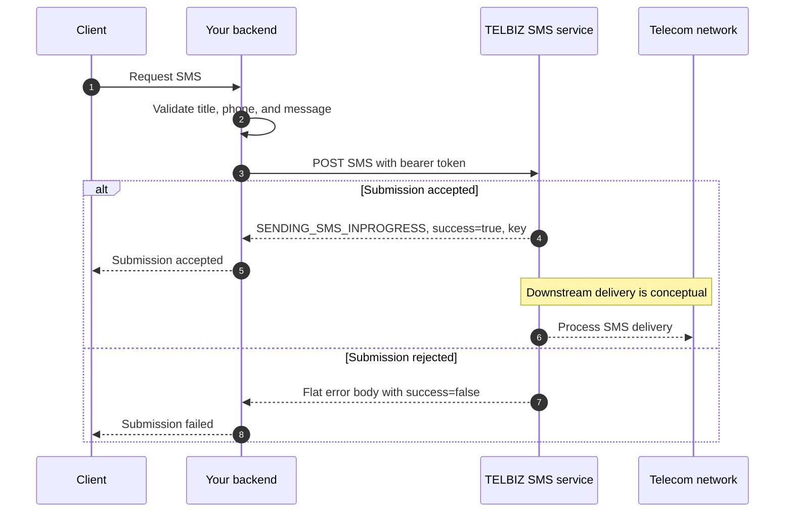
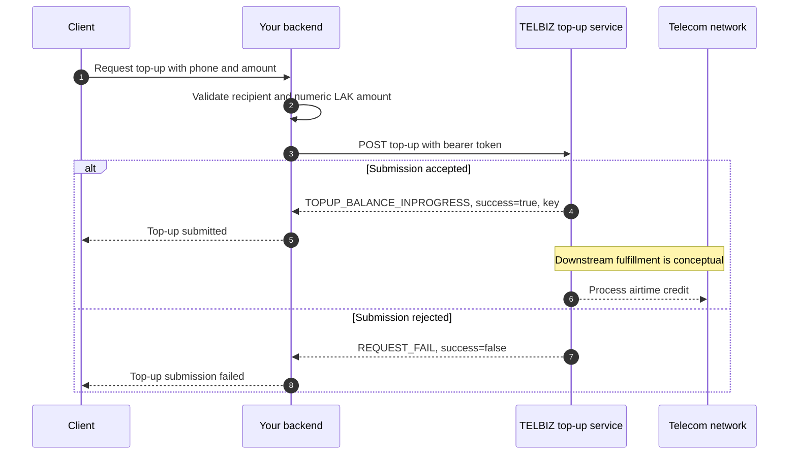
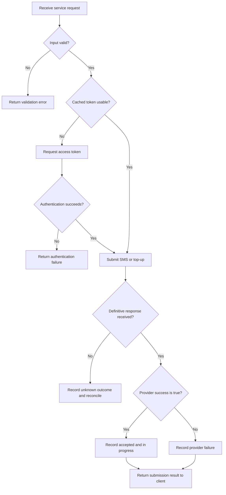

# TELBIZ API Reference

REST API v1 · Reviewed 2026-10-12 · [Developer manual](https://telbiz.la/pages/doc/developer-manual)

This reference summarizes the live TELBIZ developer manual in English. It covers authentication, SMS submission, and mobile airtime top-up. Request and response examples follow the published schemas; no live API transactions were performed. Mermaid diagrams describe the client integration flow. Provider-side delivery is conceptual where indicated.

## Contents

1. [API overview](#1-api-overview)
2. [Credentials and authentication](#2-credentials-and-authentication)
3. [Send SMS](#3-send-sms)
4. [Mobile airtime top-up](#4-mobile-airtime-top-up)
5. [Response codes and handling](#5-response-codes-and-handling)
6. [Integration flow](#6-integration-flow)
7. [Manual inconsistencies and coverage](#7-manual-inconsistencies-and-coverage)
8. [Sources](#8-sources)

## 1. API overview

| Setting | Value |
|---|---|
| Base URL | `https://api.telbiz.la` |
| API prefix | `/api/v1` |
| Transport | HTTPS |
| Request body | JSON |
| Content type | `application/json` |
| Service authentication | `Authorization: bearer <accessToken>` |
| Access-token lifetime | 3,600 seconds (1 hour), according to the authentication page |

Append each full path below directly to the base URL. Preserve the documented route capitalization and JSON field names.

| Service | Method | Path | Bearer token |
|---|---|---|---|
| Obtain access token | `POST` | `/api/v1/Connect/token` | Not required by the documented request |
| Submit SMS | `POST` | `/api/v1/SMSService/newtransaction` | Required |
| Submit airtime top-up | `POST` | `/api/v1/TopupService/newtransaction` | Required |

### Service overview

The backend obtains a token and submits authenticated service requests. The downstream telecom network is shown conceptually; the manual does not describe TELBIZ's internal architecture.



## 2. Credentials and authentication

### Obtain credentials

1. Sign in to your TELBIZ account, or register if needed.
2. Open the dashboard.
3. Open **API Credentials** or **Developer Settings** and obtain your Client ID and Secret.

Keep these values on your backend. The service requests use the issued access token, rather than sending the client secret with every request.

### Endpoint

```http
POST https://api.telbiz.la/api/v1/Connect/token
Content-Type: application/json
```

### Request body

| Field | Type | Required | Description |
|---|---|---|---|
| `clientID` | string | Yes | Client ID from your account settings |
| `secret` | string | Yes | Secret associated with that client |
| `grantType` | string | Yes | Set to `client_credentials` |

```json
{
  "clientID": "YOUR_CLIENT_ID",
  "secret": "YOUR_CLIENT_SECRET",
  "grantType": "client_credentials"
}
```

### cURL example

```bash
curl --request POST 'https://api.telbiz.la/api/v1/Connect/token' \
  --header 'Content-Type: application/json' \
  --data '{
    "clientID": "YOUR_CLIENT_ID",
    "secret": "YOUR_CLIENT_SECRET",
    "grantType": "client_credentials"
  }'
```

### Successful response

The manual labels this example **HTTP 200**. The token below is a placeholder.

```json
{
  "accessToken": "YOUR_ACCESS_TOKEN",
  "expire": 3600,
  "code": "SUCCESS_OPERATION",
  "message": "Operation successful",
  "success": true
}
```

| Field | Type | Description |
|---|---|---|
| `accessToken` | string | Token to place in the service authorization header |
| `expire` | number | Token lifetime, documented as 3,600 seconds |
| `code` | string | Provider result code; `SUCCESS_OPERATION` in the success example |
| `message` | string | Provider result message |
| `success` | boolean | Whether authentication succeeded |

The manual does not provide a separate refresh-token endpoint. Obtain a new access token through this endpoint when needed.

### Authentication flow



Caching and local expiration tracking are integration recommendations, not descriptions of TELBIZ internals.

## 3. Send SMS

### Endpoint and headers

```http
POST https://api.telbiz.la/api/v1/SMSService/newtransaction
Authorization: bearer YOUR_ACCESS_TOKEN
Content-Type: application/json
```

Creates an SMS submission for a recipient number. The manual permits these sender headings: `OTP`, `Info`, `Promotion`, and `News`.

### Request body

| Field | Type | Required | Description |
|---|---|---|---|
| `title` | string | Yes | One of `OTP`, `Info`, `Promotion`, `News` |
| `phone` | string | Yes | Recipient number with 10 characters, shown as `20xxxxxxxx` |
| `message` | string | Yes | SMS text |

```json
{
  "title": "OTP",
  "phone": "2012345678",
  "message": "Your verification code is 123456"
}
```

`phone` is a string. The example number and OTP are illustrative; replace them with the intended recipient and message. The manual does not state a maximum message length, encoding rules, or SMS segment billing rules.

### cURL example

```bash
curl --request POST 'https://api.telbiz.la/api/v1/SMSService/newtransaction' \
  --header 'Authorization: bearer YOUR_ACCESS_TOKEN' \
  --header 'Content-Type: application/json' \
  --data '{
    "title": "OTP",
    "phone": "2012345678",
    "message": "Your verification code is 123456"
  }'
```

### Successful submission response

The manual labels this example **HTTP 200**.

```json
{
  "response": {
    "code": "SENDING_SMS_INPROGRESS",
    "message": "Sending SMS inprogress",
    "success": true,
    "detail": "Sending SMS inprogress"
  },
  "key": {
    "partitionKey": "",
    "rangeKey": ""
  }
}
```

| JSON path | Type | Description |
|---|---|---|
| `response` | object | SMS submission result |
| `response.code` | string | `SENDING_SMS_INPROGRESS` for accepted, in-progress submission |
| `response.message` | string | Provider message |
| `response.success` | boolean | Submission success indicator |
| `response.detail` | string | Additional result detail |
| `key` | object | Returned transaction key, shown in the manual's example |
| `key.partitionKey` | string | Provider key component; example is empty |
| `key.rangeKey` | string | Provider key component; example is empty |

`SENDING_SMS_INPROGRESS` means TELBIZ has accepted the request and is processing the SMS. It does not establish final delivery to the recipient. The manual does not define the uniqueness or lookup semantics of the returned key fields.

### Failure response

The manual groups failures under **HTTP 4xx** without specifying an exact status for each code. The failure body is flat, unlike the nested submission-success body.

```json
{
  "code": "UNSUPPORTED_HEADER",
  "message": "N/A",
  "success": false,
  "detail": "N/A"
}
```

Other documented SMS failures include `SEND_SMS_FAIL`.

### SMS service flow



This flow does not imply a documented delivery callback or status-query API.

## 4. Mobile airtime top-up

### Endpoint and headers

```http
POST https://api.telbiz.la/api/v1/TopupService/newtransaction
Authorization: bearer YOUR_ACCESS_TOKEN
Content-Type: application/json
```

Creates a top-up submission for a recipient mobile number.

### Request body

| Field | Type | Required | Description |
|---|---|---|---|
| `phone` | string | Yes | Recipient number with 10 characters, shown as `20xxxxxxxx` |
| `amount` | number | Yes | Top-up amount in Lao kip (LAK); the field description says amounts start at 10,000 kip |

```json
{
  "phone": "2012345678",
  "amount": 10000
}
```

Send `amount` as a JSON number, without quotes or thousands separators. The manual does not enumerate permitted denominations or specify a maximum amount.

### cURL example

```bash
curl --request POST 'https://api.telbiz.la/api/v1/TopupService/newtransaction' \
  --header 'Authorization: bearer YOUR_ACCESS_TOKEN' \
  --header 'Content-Type: application/json' \
  --data '{
    "phone": "2012345678",
    "amount": 10000
  }'
```

### Successful submission response

The manual labels this example **HTTP 200**.

```json
{
  "response": {
    "code": "TOPUP_BALANCE_INPROGRESS",
    "message": "Topup Balance Inprogress",
    "success": true,
    "detail": "Topup Balance Inprogress"
  },
  "key": {
    "partitionKey": "",
    "rangeKey": ""
  }
}
```

The response uses the same nested envelope as SMS submission, with `response.code` set to `TOPUP_BALANCE_INPROGRESS`. TELBIZ has accepted the top-up request and is processing it; this response does not establish that the mobile balance has already been credited.

### Failure response

The manual labels this example **HTTP 4xx**, without identifying an exact status.

```json
{
  "code": "REQUEST_FAIL",
  "message": "Request failed",
  "success": false,
  "detail": "Request failed"
}
```

### Top-up service flow



## 5. Response codes and handling

The response-code page instructs clients to check `success` first, then examine `code`. Their JSON locations depend on the response shape.

| Response shape | Success location | Code location |
|---|---|---|
| Authentication success | `success` | `code` |
| SMS or top-up submission success | `response.success` | `response.code` |
| Documented service failure | `success` | `code` |

### Documented codes

| Code | Meaning | Handling |
|---|---|---|
| `SUCCESS_OPERATION` | Authentication succeeded | Use the returned `accessToken` |
| `SENDING_SMS_INPROGRESS` | SMS accepted and being processed | Record submission as accepted/in progress |
| `TOPUP_BALANCE_INPROGRESS` | Top-up accepted and being processed | Record submission as accepted/in progress |
| `UNSUPPORTED_HEADER` | Requested SMS heading is not permitted | Use `OTP`, `Info`, `Promotion`, or `News` |
| `SEND_SMS_FAIL` | SMS submission failed | Check the 10-character phone format and account credit |
| `REQUEST_FAIL` | Request failed | Check request body and token expiry; the manual also suggests trying later |

### Client handling recommendations

These are integration recommendations rather than additional TELBIZ guarantees:

- Check the HTTP status and parse the appropriate JSON envelope. Do not treat HTTP 200 alone as application success.
- Record the provider code and returned key values when present.
- Track in-progress submissions separately from confirmed delivery or completed airtime credit.
- On a timeout or connection failure, treat the submission outcome as unknown. A request may have reached TELBIZ even if its response did not reach your backend.
- Reconcile unknown outcomes before repeating an SMS or top-up request. The inspected manual provides no idempotency contract.
- Obtain another access token when the current one expires. Bound authentication retries to avoid a loop.
- Redact credentials, bearer tokens, recipient numbers, and OTP content from logs.

## 6. Integration flow

This recommended backend flow applies to both service endpoints. Local validation, token caching, record storage, and outcome reconciliation belong to your integration.



The manual does not document a reconciliation endpoint. Establish a provider-supported way to investigate unknown or final outcomes before implementing automatic retries of billable operations.

## 7. Manual inconsistencies and coverage

### Published inconsistencies

| Topic | What the manual shows | Treatment in this reference |
|---|---|---|
| Token lifetime | Overview table says `3600 ms`; overview card says one hour; authentication page says 3,600 seconds and returns `expire: 3600` | Use the authentication page's 3,600-second lifetime |
| Top-up amount | Field table requires `number`; sample body uses the string `"10,000 "` | Use numeric `10000`, following the schema |
| SMS response heading | A heading mentions failure above a table that includes the success code | Follow the nested success example and response-code page |
| HTTP errors | Service examples are grouped as `4xx` | Do not assign undocumented exact status codes |

### Details absent from the inspected manual

The linked manual pages do not define data-package endpoints, delivery webhooks, final-status queries, idempotency keys, request rate limits, sandbox credentials, supported-operator lists, SMS length/encoding limits, or a complete HTTP status mapping. Confirm these with TELBIZ if your integration needs them.

This reference supersedes the earlier SDK-derived version of this file. Its contract comes from the current live manual; routes and services found only in an older SDK are outside this reference's scope.

## 8. Sources

The following TELBIZ pages were read directly on 2026-10-12:

- [Developer manual and overview](https://telbiz.la/pages/doc/developer-manual)
- [Client ID and Secret setup](https://telbiz.la/pages/doc/developer-manual/clientid)
- [Authentication](https://telbiz.la/pages/doc/developer-manual/authentication)
- [SMS service](https://telbiz.la/pages/doc/developer-manual/sms)
- [Top-up service](https://telbiz.la/pages/doc/developer-manual/topup)
- [Response codes](https://telbiz.la/pages/doc/developer-manual/response-codes)

Examples reproduce the documented structures using placeholder credentials and illustrative input. They are documentation examples, not captured responses from live API calls.
