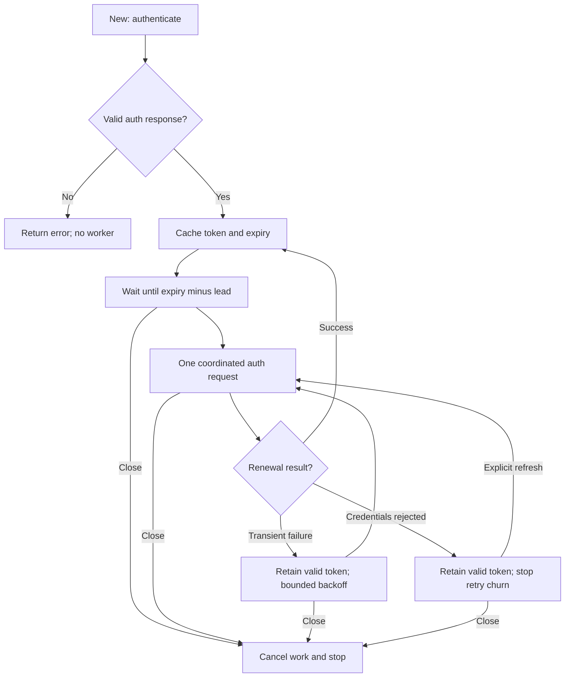

# Access-Token Lifecycle Contract

This defines SDK behavior. Telbiz's supplied contract defines the token endpoint
and lifetime; it does not guarantee overlapping-token validity or internal token
issuance behavior. Record this as an integration uncertainty.

## Initialization and expiry

1. `New(ctx, cfg)` validates config and makes initial authentication within the
   caller's context and the SDK request timeout.
2. Require provider success, nonempty access token, and a positive integer
   lifetime in seconds. Reject missing, fractional, zero, negative, or overflowing
   lifetime values. Validate safe conversion to `time.Duration`.
3. Conservatively compute `expiresAt = authRequestStartedAt + lifetime`. This
   avoids adding response latency to the lifetime. Reject a response whose usable
   lifetime is already exhausted on arrival.
4. Install the token and deadline atomically and start one client lifecycle loop.
   A failed constructor leaves no active goroutine or timer.
5. The constructor context only governs initialization. After success, the SDK
   uses its own cancelable lifecycle context, stopped by `Close`.

Default refresh lead is 60 seconds. Effective lead is
`min(configuredLead, lifetime / 2)` so a short-lived token cannot produce an
immediate renewal loop. Normal one-hour tokens still use the full 60-second lead.
`refreshAt = expiresAt - effectiveLead`. If that point passed during the auth
request but the token is still valid, schedule a bounded renewal promptly; never
spin in an immediate success/renew loop. Use a positive minimum scheduling delay
and document its behavior for exceptionally slow auth responses.

Successful renewal recomputes both deadlines from the new response and resets
the scheduler. Renew even with no service traffic. Use timers rather than a
periodic busy poll. Tests should control time without waiting an hour.

## Concurrency and request acquisition

- All token reads/replacements must be race-free. Do not hold a state mutex while
  making HTTP calls or waiting for another operation.
- At most one auth operation is in flight per client across background renewal,
  request-triggered renewal, and `RefreshToken`.
- Service calls may use the current token while it remains unexpired, including
  while proactive renewal is running. Snapshot its generation with the token.
- If no valid token exists, join or start the coordinated auth operation and wait
  with the service caller's context. Submit no service request on auth failure.
- Caller cancellation stops that caller's wait, not a renewal needed by other
  callers. Shared auth work uses lifecycle context plus a bounded timeout.
- `RefreshToken` forces renewal unless an operation is already in progress, in
  which case it joins it. Respect cancellation without canceling shared work.
- Prevent sequential failure storms as well as concurrent duplication: keep a
  shared retry/cooldown deadline so new requests cannot bypass transient backoff.
- If a 401 came from generation N, only invalidate N if it is still current.
  Never invalidate N+1 because an older request finished later.
- Renewal failure never replaces or clears a still-valid token. Token snapshots
  sent to a request cannot be changed midway through that request.

## Renewal failures

Use finite auth request timeouts and capped backoff for transient failures.
Define and document exact bounds; defaults such as 1, 2, 4, 8 seconds, capped at
30 seconds, are acceptable. Retry authentication only, never SMS/top-up.

When a retry is scheduled before expiry, account for the remaining validity; after
expiry, retain bounded backoff instead of a zero-delay loop. A renewed token must
be valid when installed. Tests must prove no tight-loop behavior at expiry.

Definitive credential rejection stops automatic retry churn. Retain an unexpired
old token until its deadline, expose the subsequent authentication failure to
callers, and allow an explicit `RefreshToken` attempt. Do not classify an unknown
provider code as transient or terminal without an explicit documented SDK policy.

If a valid old token exists, service calls may proceed; if none exists, they wait
for an allowed refresh attempt or return an inspectable authentication/context
error. They must never submit with an expired token. Explain this behavior in
`docs/AUTHENTICATION.md`, including how background failures become visible when
authentication is required. Optional diagnostic hooks must be secret-free and
must not block the renewal loop indefinitely.

## Shutdown

`Close()` is idempotent and safe under concurrent calls. It marks the client
closed, cancels pending lifecycle auth work, stops the timer, unblocks refresh
waiters, and joins the client-owned lifecycle goroutine. No new renewal or service
submission may start after closure. Already-started service calls may complete
under their own context and finite timeout; document this distinction. Calls
after closure return a recognizable closed-client error.

Do not close an injected caller-owned HTTP client or transport. Close idle
connections only for SDK-owned transport resources. Document that custom
RoundTrippers must honor cancellation and must not retry service POSTs.

## Lifecycle flow

