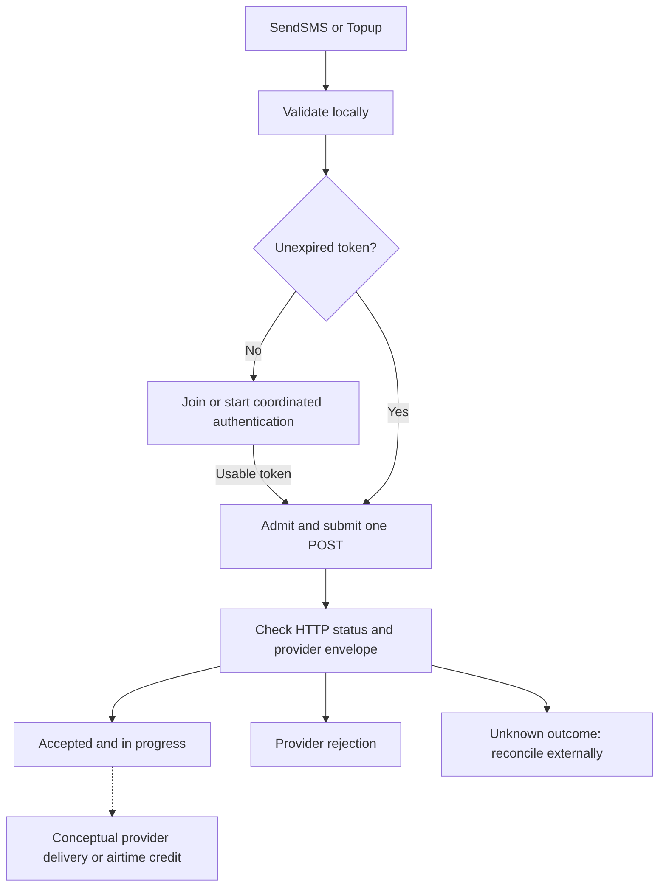

# Usage

Import `github.com/barlus-developer/golang-sdk-telbiz` as `telbiz`. The module
minimum and locally verified toolchain are Go 1.27.1. See the complete
[quick start](../README.md#quick-start) and [examples](../examples).

## Configuration

| `Config` field | Default | Contract |
|---|---|---|
| `ClientID` | Required | Nonblank; sent unchanged in authentication JSON |
| `ClientSecret` | Required | Nonblank; sent unchanged only to token endpoint |
| `BaseURL` | `https://api.telbiz.la` | Absolute origin; optional trailing slash; no credentials, query, fragment, or path prefix |
| `HTTPClient` | Private standard HTTP client/transport | Copied; caller's client and transport are never mutated or closed |
| `RefreshBefore` | 60 seconds when zero | Nonnegative; actual lead is capped at half the returned token lifetime |

`RequestTimeout` is a constant 30 seconds. Every call applies this bound through
its request context. An earlier caller deadline or injected client timeout wins.
The response body limit is 1 MiB. Configuration is copied at construction; do not
modify the provided client concurrently with `New`. A later change to the
original client fields does not configure the SDK's private client copy.

Keep Client ID/Secret in backend environment variables or a secret manager.
`.env.example` has empty placeholders; the SDK does not read environment files.

## Reuse, contexts, and cleanup

`New` authenticates eagerly, so handle its error before using the client.
Its context only controls initialization. After success, renewal has an
independent lifecycle context and continues even if startup is canceled.
Reuse one client for concurrent service calls and defer `Close()` immediately.
Do not use the zero value of `Client` or copy an initialized client.

Pass a nonnil context to each operation. A canceled service context stops that
call, including its token wait. A canceled `RefreshToken` context stops only that
waiter; shared authentication continues for other callers until its HTTP timeout
or `Close`. No new service call is admitted after closure. An admitted service
call may still finish, so keep and cancel its own context if shutdown requires
it to stop. `Close` waits for renewal work, not for admitted service calls.

See the [lifecycle example](../examples/lifecycle/main.go) for signal handling.
Clients renew independently; there is no global or distributed token cache.

## HTTP customization

Given your own `httpClient` and initialization `ctx`:

```go
client, err := telbiz.New(ctx, telbiz.Config{
    ClientID: os.Getenv("TELBIZ_CLIENT_ID"),
    ClientSecret: os.Getenv("TELBIZ_CLIENT_SECRET"),
    HTTPClient: httpClient,
    RefreshBefore: 2 * time.Minute,
})
```

The SDK overrides redirect handling on its private client copy. Neither token
credentials nor bearer-authenticated bodies follow redirects. The request body
does not expose `GetBody` for replay. Custom RoundTrippers must honor cancellation
and **must not retry billable POSTs**. A transport that ignores context can
prevent bounded shutdown. Any injected transport, including a default transport
selected by an injected client, remains caller-owned.

`BaseURL` accepts HTTPS origins. HTTP is permitted only when explicitly configured
with `localhost` or a loopback IP for local testing/development, for example
`httptest.Server.URL`. Use HTTPS with TLS verification in production. A base URL
with a path prefix is rejected so documented route paths remain exact.

## Request rules

- SMS titles: `TitleOTP`, `TitleInfo`, `TitlePromotion`, `TitleNews`.
- Phone: ten ASCII digits, beginning with `20`. No `+856` normalization occurs.
  This checks formatting only; it does not establish allocation/operator support.
- Message: nonblank. Its whitespace and contents are transmitted unchanged.
  No undocumented length limit is imposed.
- Top-up amount: `int64`, whole LAK, at least 10,000. No additional denomination
  or maximum amount is assumed.

See [SMS](../examples/sms/main.go) and [top-up](../examples/topup/main.go) programs
for complete environment-based examples. Explicit execution is billable.



The downstream step is conceptual. No final-status or reconciliation endpoint is
documented. See [error handling](ERROR_HANDLING.md) before considering repetition.
